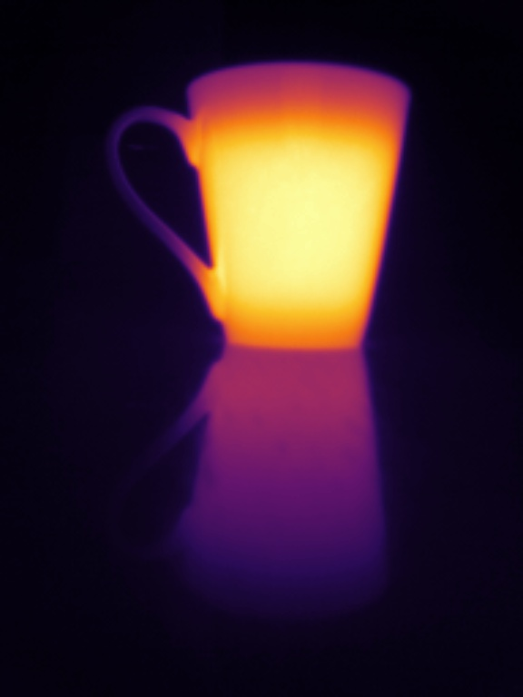
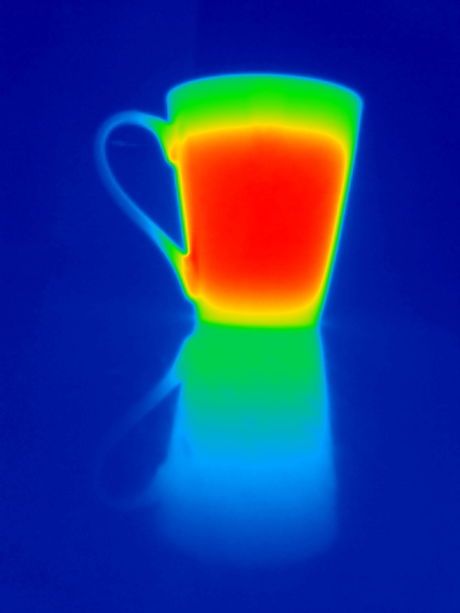
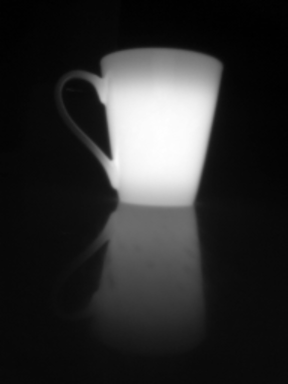
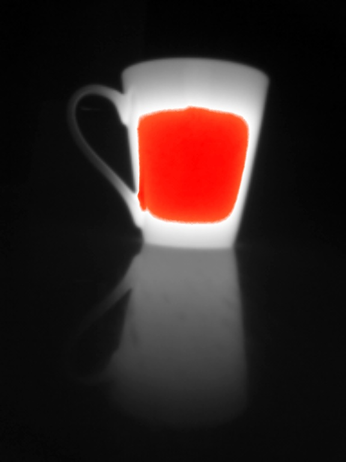
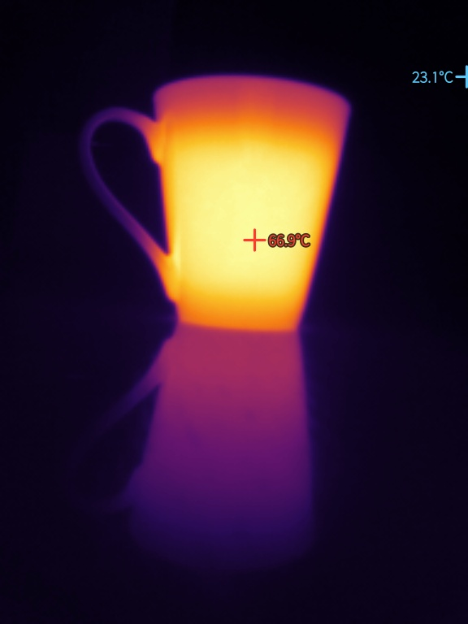
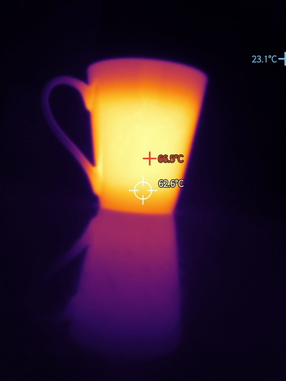
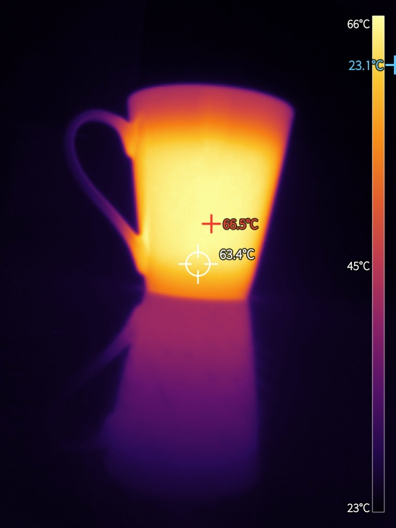
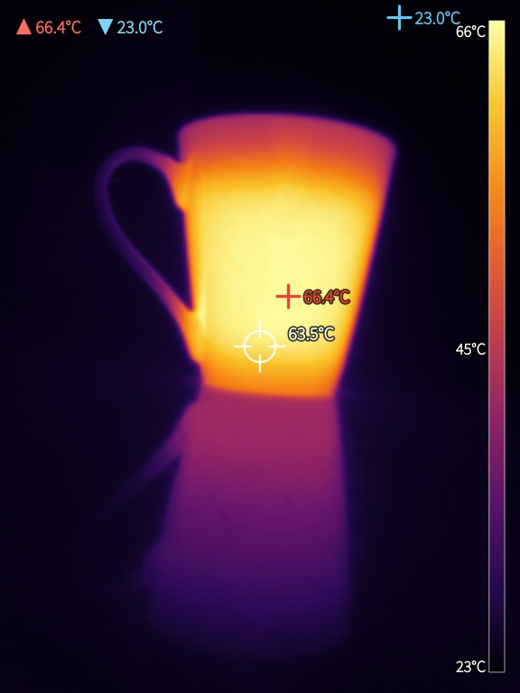
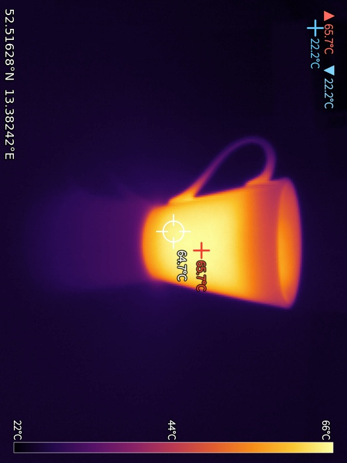
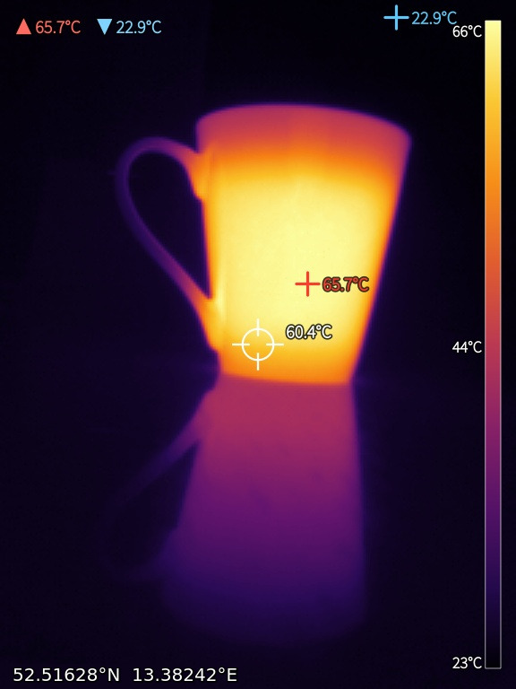

# harbour-ircam

**A thermal camera viewer for the InfiRay P2 Pro on Sailfish OS.**

This app is more or less a byproduct of my much larger **LabCam** app
([JimKnopfIoT/labcam-phone](https://github.com/JimKnopfIoT/labcam-phone)): I
took the pure IR function out of it and provide it here on its own. It turns the
InfiRay P2 Pro USB-C thermal camera into a live viewfinder with real temperature
measurement, running entirely on the device — no network access, no telemetry.
Snapshots carry no location or device data unless I switch the location overlay
on myself.

Tested on a Sony Xperia 10 III with an InfiRay P2 Pro.

## Screenshots

<table>
  <tr>
    <td></td>
    <td></td>
    <td></td>
    <td></td>
    <td></td>
  </tr>
  <tr>
    <td></td>
    <td></td>
    <td></td>
    <td></td>
    <td></td>
  </tr>
  <tr>
    <td></td>
    <td></td>
    <td></td>
  </tr>
</table>

## What it does

- **Live thermal view** in every orientation, with a choice of palettes
  (Lava/Inferno, Ironbow, Rainbow, White-hot, Black-hot, and Grey with only the
  hottest peaks in red). Pinch to zoom, drag to pan, double-tap to cycle zoom.
- **Temperature measurement** decoded from the camera's own 16-bit data:
  the hottest and coldest spot, an optional centre spot, and up to six
  tap-to-place measurement points, each with its reading, plus a colour bar
  scaled to the picture.
- **Automatic temperature scaling** that follows the scene but never stretches
  the palette across less than a few degrees, so a nearly uniform scene stays
  soft instead of blowing up into a hard white blob.
- **Sharpening** in three steps — Off, Normal, Superfine — to bring out fine
  detail in the low-resolution sensor picture.
- **Calibration offset** — nudge every reading up or down to match a known
  reference, plus a Celsius/Fahrenheit switch throughout.
- **Overlays** you toggle from the viewfinder and that are burnt identically
  into both snapshots and videos: the min/max readout, the centre spot, the
  colour bar, a date-and-time stamp, and a location line with GPS coordinates in
  decimal, nautical or navigation format.
- **Snapshots** saved as JPEG in `~/Pictures/IrCam`, overlays burnt in at three
  times the sensor resolution. Optionally the raw per-pixel temperature grid is
  written next to each picture as CSV.
- **Video recording** of the composed view — all overlays, including the live
  coordinates, burnt in — as compressed VP8/WebM, with a compression slider in
  the settings.
- **Facing out or facing you** — a user-facing camera turns the wrong way in
  landscape, so switch on “Camera points at me” when you turn it around. The
  plug/lens direction cannot be detected automatically, so it is a manual switch.
- **Gallery** — swipe the centre of a picture to step through captures, play
  back videos, rename, delete and share from the pulley.
- **Camera database with auto-detection** — known cameras are recognised by
  their USB id and stream format; an unknown UVC camera is probed and shown
  image-only. See the supported-camera table and your camera's own measured
  values on the camera page, save a detected camera, and export a data point to
  help add support for more models.

## Supported hardware

The **InfiRay P2 Pro** (USB `0bda:5830`), a 256×192 USB-C thermal camera. It
is a standard UVC device, so the kernel presents it as `/dev/videoN` and the
app reads it over V4L2. The stream is 256×384 — the picture on top, a 16-bit
temperature value per pixel underneath. Other cameras of the same family that
deliver the same stream layout (e.g. the Topdon TC001) are likely to work but
have not been tested.

## A note on accuracy

Temperatures are what the sensor reports, corrected only by an offset you can
set. Readings depend on the emissivity of the surface: matte paint, skin, wood
and most plastics read well; bare or shiny metal reflects its surroundings and
reads far too low. Treat the readings as a guide, not a calibrated measurement.

## Building

```sh
mb2 --target SailfishOS-<version>-aarch64 build
```

Requires `sailfishsilica-qt5` and `nemo-qml-plugin-configuration-qt5` at
runtime; a Qt5 + sailfishapp toolchain to build. No external libraries.

## Credit

The app structure follows the sibling harbour-pipecam. The temperature decode
(`raw / 64 − 273.15`) is the same formula the open pyThermalCamera project uses
for this sensor family.

AI assisted development

## Licence

GNU General Public License v3.0 or later. Provided as is, with no warranty.
