# harbour-ircam

**A thermal camera viewer for the InfiRay P2 Pro on Sailfish OS.**

This app is more or less a byproduct of my much larger **LabCam** app
([JimKnopfIoT/labcam-phone](https://github.com/JimKnopfIoT/labcam-phone)): I
took the pure IR function out of it and provide it here on its own. It turns the
InfiRay P2 Pro USB-C thermal camera into a live viewfinder with real temperature
measurement, running entirely on the device — no network access, no telemetry.
Snapshots carry no location or device data unless I switch the location overlay
on myself.

Tested on a Sony Xperia 10 III and a Jolla Phone (2026) with an InfiRay P2 Pro.

## Screenshots

<table>
  <tr>
    <td>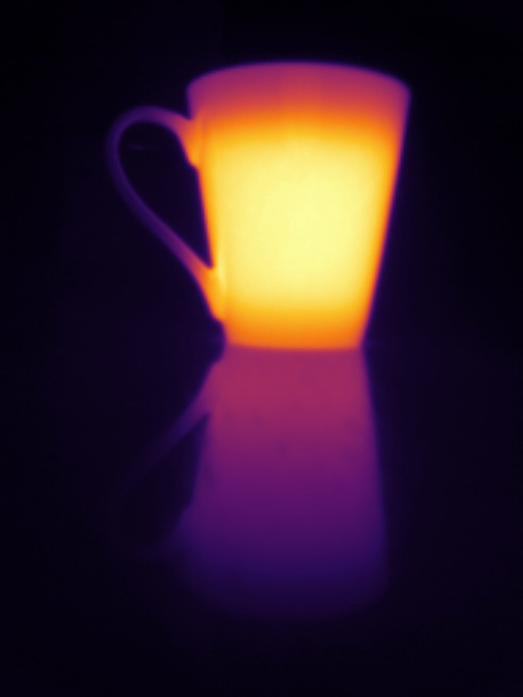</td>
    <td>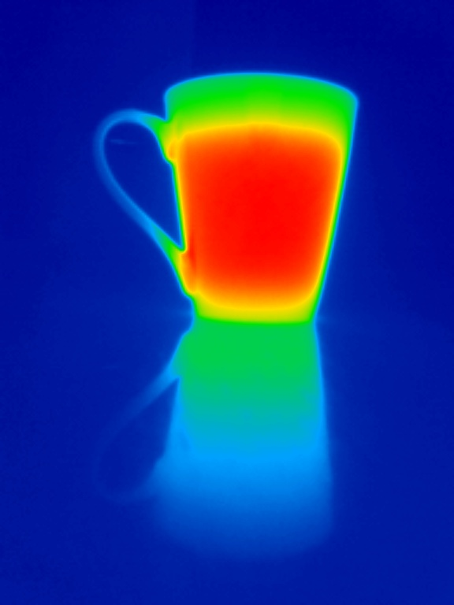</td>
    <td>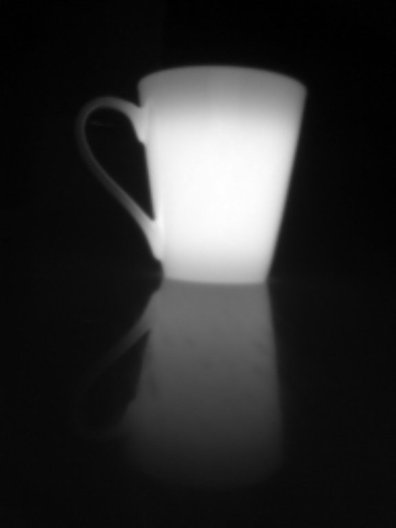</td>
    <td></td>
    <td>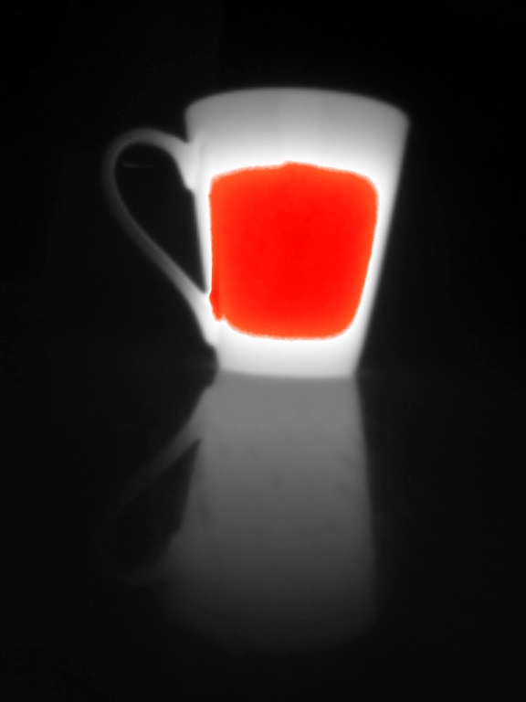</td>
  </tr>
  <tr>
    <td>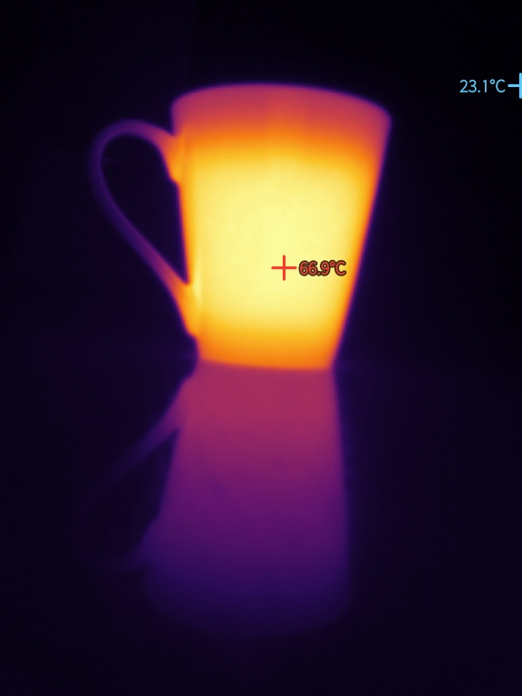</td>
    <td>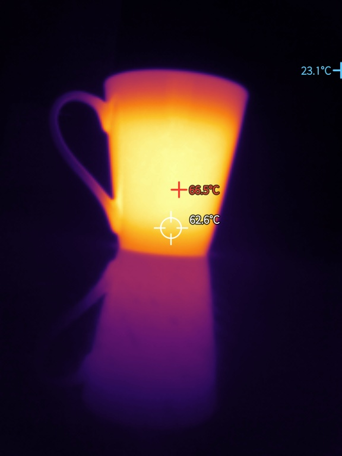</td>
    <td>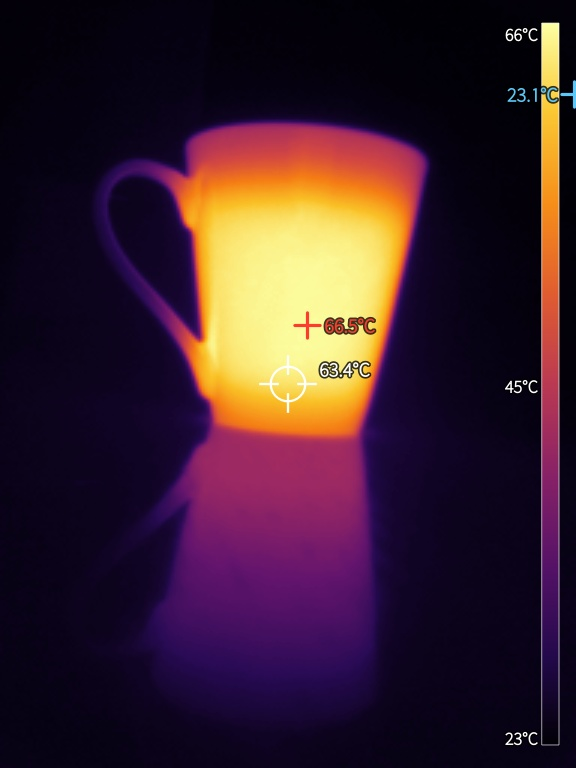</td>
    <td>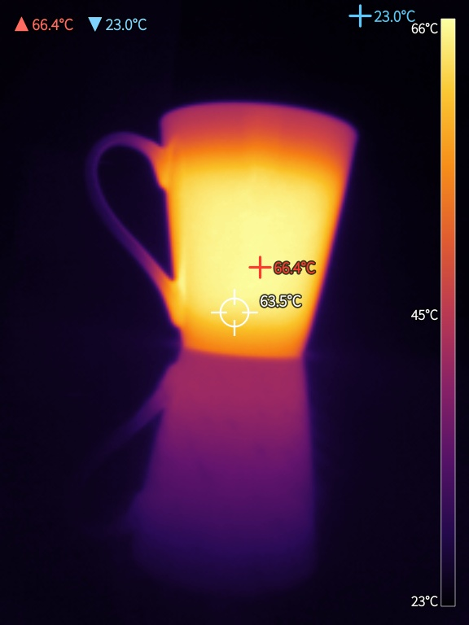</td>
    <td></td>
  </tr>
  <tr>
    <td>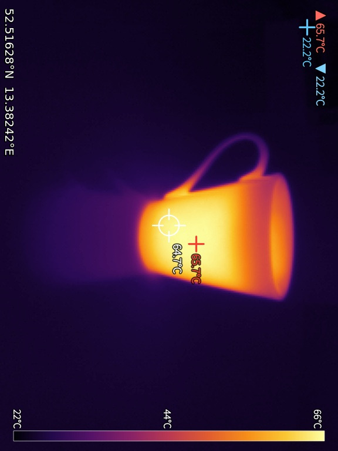</td>
    <td></td>
    <td>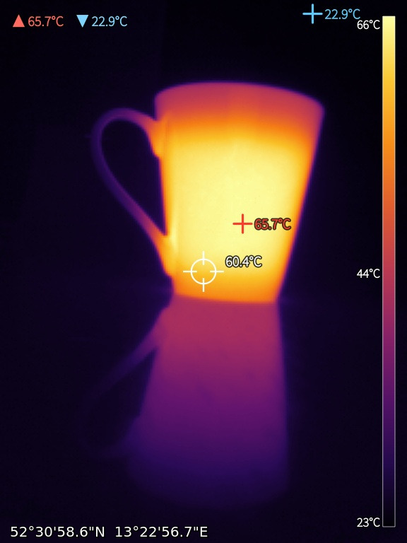</td>
  </tr>
</table>

## What it does

- **Live thermal view** in every orientation, with a choice of palettes
  (Lava/Inferno, Ironbow, Rainbow, White-hot, Black-hot, Grey with only the
  hottest peaks in red, Turbo, Magma, Plasma, Viridis and Hot). Pinch to zoom, drag to pan, double-tap to cycle zoom.
- **Temperature measurement** decoded from the camera's own 16-bit data:
  the hottest and coldest spot, an optional centre spot, and up to six
  tap-to-place measurement points, each with its reading, plus a colour bar
  scaled to the picture.
- **Automatic temperature scaling** that follows the scene but never stretches
  the palette across less than a few degrees, so a nearly uniform scene stays
  soft instead of blowing up into a hard white blob.
- **Sharpening** in three steps — Off, Normal, Superfine — to bring out fine
  detail in the low-resolution sensor picture.
- **Two measuring ranges** on the P2 Pro — −20 … 150 °C or 100 … 600 °C,
  switched from the viewfinder (see below for the one-time setup).
- **Emissivity and calibration offset** — correct readings for the surface
  (grey body, against the reflected temperature) and nudge them to match a
  known reference, plus a Celsius/Fahrenheit switch throughout.
- **Overlays** you toggle from the viewfinder and that are burnt identically
  into both snapshots and videos: the min/max readout, the centre spot, the
  colour bar, a date-and-time stamp, and a location line with GPS coordinates in
  decimal, nautical or navigation format.
- **Snapshots** saved as JPEG in `~/Pictures/IrCam`, overlays burnt in at three
  times the sensor resolution. Optionally the raw per-pixel temperature grid is
  written next to each picture as CSV.
- **Video recording** of the composed view — all overlays, including the live
  coordinates, burnt in — as compressed VP8/WebM, with a compression slider in
  the settings.
- **Facing out or facing you** — a user-facing camera turns the wrong way in
  landscape, so switch on “Camera points at me” when you turn it around. The
  plug/lens direction cannot be detected automatically, so it is a manual switch.
- **Gallery** — swipe the centre of a picture to step through captures, play
  back videos, rename, delete and share from the pulley.
- **Camera database with auto-detection** — known cameras are recognised by
  their USB id and stream format; an unknown UVC camera is probed and shown
  image-only. See the supported-camera table and your camera's own measured
  values on the camera page, save a detected camera, and export a data point to
  help add support for more models.

## Supported hardware

The **InfiRay P2 Pro** (USB `0bda:5830`), a 256×192 USB-C thermal camera. It
is a standard UVC device, so the kernel presents it as `/dev/videoN` and the
app reads it over V4L2. The stream is 256×384 — the picture on top, a 16-bit
temperature value per pixel underneath. Other cameras of the same family that
deliver the same stream layout (e.g. the Topdon TC001) are likely to work but
have not been tested.

## "No camera" on the Jolla Phone (2026) since Sailfish OS 5.2.0.22

The hardware adaptation that came with the 5.2.0.22 update (`droid-hal-jp2601`)
ships a udev rule that gives every `/dev/video*` node the owner `camera`, group
`system` and mode `0660`. That includes a plugged-in USB camera, so the user
session can no longer open it and the app keeps asking you to plug the camera
in, although the kernel has found it. You can confirm this as root while the
camera is plugged in:

```sh
ls -l /dev/video*   # the USB camera node shows "camera system"
```

Until this is changed in the system, a one-line udev rule hands the P2 Pro's
nodes back to the `video` group. As root (developer mode):

```sh
cat > /etc/udev/rules.d/999-harbour-ircam.rules <<'EOR'
SUBSYSTEM=="video4linux", ATTRS{idVendor}=="0bda", ATTRS{idProduct}=="5830", GROUP="video", MODE="0660"
EOR
udevadm control --reload-rules
```

Then unplug the camera and plug it in again. The file name must sort after
`999-android-system.rules`, or that rule wins. Only the thermal camera is
affected; the phone's own camera nodes stay as they are. To undo, delete the
file. An app from the store cannot install such a rule itself.

## Measuring range (P2 Pro)

The P2 Pro measures in two ranges: −20 … 150 °C (the default, finer) and
100 … 600 °C (coarser, for soldering irons, ovens and the like). Switch with the
"150°/600°" button in the viewfinder or under Settings → Measurement. The
picture stands still for about three seconds while the camera recalibrates.

<table>
  <tr>
    <td>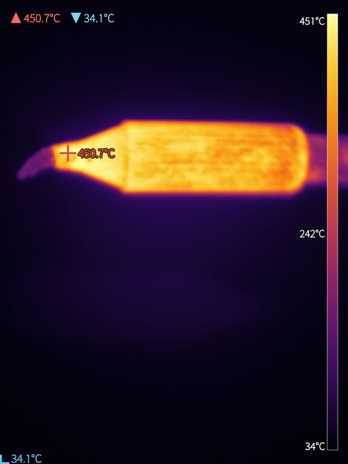</td>
    <td>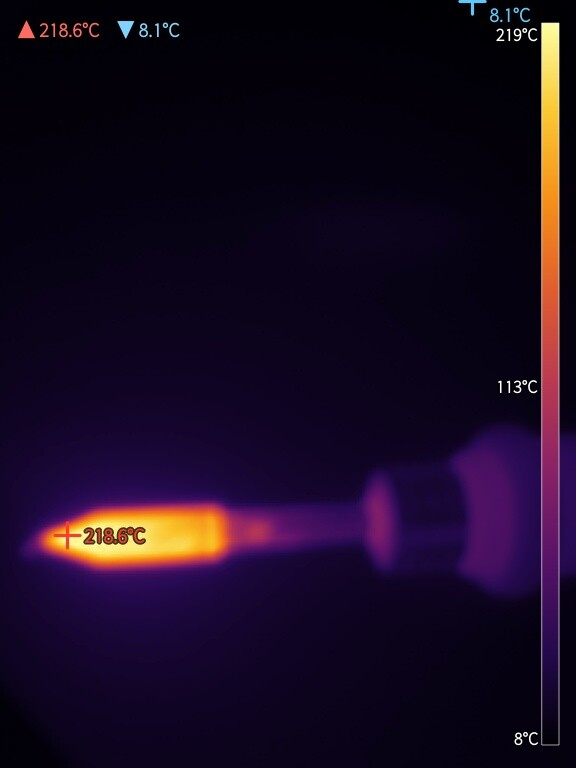</td>
  </tr>
  <tr>
    <td>Soldering iron set to 450 °C, 100 … 600 °C range: 450.7 °C</td>
    <td>The same iron at 220 °C, −20 … 150 °C range: 218.6 °C</td>
  </tr>
</table>

Both at emissivity 0.73, the value that fits this tip (see the note on
accuracy below).

The switch is not a video setting: the app sends a vendor command to the camera
over the USB device node (`/dev/bus/usb/…`), which only root can write to by
default — on any phone, not only the Jolla. If the app reports "No write
access", add a second line to the rule file above, as root:

```sh
cat >> /etc/udev/rules.d/999-harbour-ircam.rules <<'EOR'
SUBSYSTEM=="usb", ENV{DEVTYPE}=="usb_device", ATTR{idVendor}=="0bda", ATTR{idProduct}=="5830", GROUP="video", MODE="0660"
EOR
udevadm control --reload-rules
```

Then unplug the camera and plug it in again. This line only affects the P2 Pro
and works on its own, too, if your phone does not need the first one. The
camera starts in the default range every time it is plugged in; the app sets
the chosen range again when it connects.

The command protocol comes from
[P2Pro-Viewer](https://github.com/LeoDJ/P2Pro-Viewer) (LeoDJ, MIT) and
[p2-viewer](https://github.com/lbatalha/p2-viewer) (lbatalha, MIT).

## A note on accuracy

Temperatures are what the sensor reports, corrected by the offset and the
emissivity you set. Readings depend on the emissivity of the surface: matte
paint, skin, wood and most plastics read well at 0.90–0.95. Metal reflects its
surroundings and reads too low unless the emissivity is lowered: soldering
tips and oxidised or plated metal need around 0.7 — a JBC tip read right at
0.73 from 220 to 450 °C. Polished aluminium or copper (0.03–0.10) cannot be
measured reliably; put a piece of matte tape on it. These values are starting
points: fine-tune against something of known temperature. Treat the readings
as a guide, not a calibrated measurement.

## Building

```sh
mb2 --target SailfishOS-<version>-aarch64 build
```

Requires `sailfishsilica-qt5` and `nemo-qml-plugin-configuration-qt5` at
runtime; a Qt5 + sailfishapp toolchain to build. No external libraries.

## Credit

The app structure follows the sibling harbour-pipecam. The temperature decode
(`raw / 64 − 273.15`) is the same formula the open pyThermalCamera project uses
for this sensor family.

## Licence

GNU General Public License v3.0 or later. Provided as is, with no warranty.

LLM assisted development
